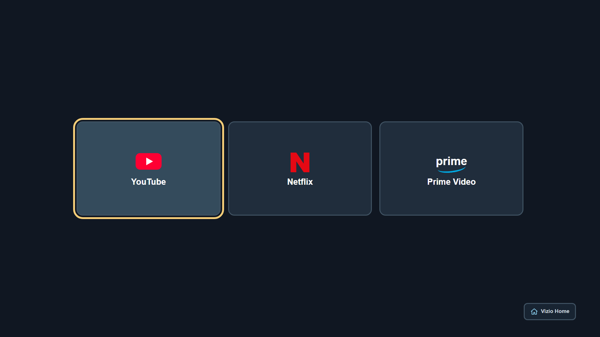

# Simple Vizio Launcher

A quiet, remote-friendly home screen for a compatible Vizio TV. A small program on a computer on your home network serves three large app buttons and brings the screen back when the TV opens Vizio Home. The layout is intentionally easy to read from across the room, including for people who prefer fewer choices.



*This is a browser-rendered screenshot of the actual page, not a photograph of the television.*

The idea is similar to [couch-tv](https://github.com/Seagey/couch-tv), another project exploring quieter TV home screens. This project is a small, separate Vizio-focused implementation; see [couch-tv's Vizio notes](https://github.com/Seagey/couch-tv/blob/main/docs/VIZIO.md) for its own beta approach and compatibility information.

## What it does

- Shows YouTube, Netflix and Prime Video in a large, high-contrast row. A smaller Vizio Home button opens the original home screen.
- Uses the television remote's arrows and OK. Remembers the last focused app across visits; the Vizio Home button is excluded.
- Watches for Vizio Home and opens the simple screen. Optionally redirects WatchFree to YouTube.
- Includes an experimental separate command to serve one specified local video to a TV-sized player, without adding a video library to the launcher.
- Includes an [agent skill](skills/vizio-launcher/SKILL.md) for setup, troubleshooting and local video requests.

## Status and limitations

This is experimental, not affiliated with Vizio, Netflix, YouTube, or Amazon. The launcher uses undocumented Vizio OS behavior; firmware changes and other models may work differently. It does not replace the TV OS, remove ads inside apps, or install itself on the TV.

On one **VQD55M-0804**, firmware **86.920.9.3-2**, a prototype displayed the screen, responded to the remote, launched YouTube and Prime Video, remembered selection, opened the original home, and redirected WatchFree to YouTube. The approach is not necessarily limited to that model, but other models and the generalized pairing/setup workflow have not been verified on hardware. App identifiers can vary by model; Netflix has not been independently confirmed on that TV.

The computer must be on, signed in, awake and on the same network. Once you intentionally enter Vizio Home, a second Home press while already there cannot be distinguished by the current polling approach; open an app and then press Home to return to the simple screen. When the service is stopped, the original home remains available. If the computer goes to sleep while the custom page is open, press the TV's Home button to return to Vizio Home.

Local video: H.264/AAC MP4 clips, including a 1080p sample, played on the same TV. The owner confirmed the screen-filling player, progress bar, and 5-second seeking while paused. Other video formats remain unverified. Codec support depends on the TV. This is not a file browser, transcoder, or permanent launcher tile.

## Set up

1. Install Python 3.10 or later. Put this folder on a computer on the same trusted home network as the TV. Leave the TV on.
2. Find the TV's local IPv4 address in its network information. If possible, reserve its address in your router so it does not change.
3. In a terminal in this folder, pair with the TV (replace the example address with yours):

   ```sh
   python launcher.py pair 192.168.1.50
   ```

   Enter the four-digit code shown on the TV. This writes `config.json`, which contains a secret pairing token. Keep it private. The program will not overwrite an existing config; move or back it up before pairing again.
4. Start the service:

   ```sh
   python launcher.py run
   ```

   Open the TV's Vizio Home screen. The simple screen should appear after a few seconds. Keep the process running. On Windows, allow Python access to the **private** network if the firewall prompts you.
5. Stop it with Ctrl+C. When stopped, the TV's standard home remains available.

To start it automatically after signing in, use your operating system's normal startup facility. On Windows, after pairing and testing the launcher manually, run in PowerShell from this folder:

```powershell
./install-startup.ps1
```

This adds a startup entry for the current Windows account, so Python runs the launcher in the background without Codex or a terminal window. Sign in after a restart and keep the computer awake. Moving this folder or Python later will break the saved startup path; run the installer again after moving. To remove the startup entry, run `./install-startup.ps1 -Remove`; stop an already running launcher separately. The packaged installer and a fresh Windows sign-in have not yet been tested end-to-end.

Alternatively, create a shortcut in the current user's Startup folder (`Win+R`, then `shell:startup`) that runs `pythonw.exe` with the full path to `launcher.py` and argument `run`. Use absolute paths.

## Options

After pairing, `config.json` contains the TV address, port, app identifiers and `redirect_watchfree`. Set `redirect_watchfree` to `true` to send the TV to YouTube whenever WatchFree opens. This detects the app state, so it affects *all* ways of opening WatchFree, not just the remote button. The TV and computer addresses need to remain reachable; pair again if the TV forgets the token.

App launch IDs are firmware-dependent. The included Prime Video ID is `[3, "3"]`; another common ID is `[2, "4"]`. If an app does not open, verify it works from Vizio Home and consult the [Vizio control research](https://github.com/exiva/Vizio_SmartCast_API) or your TV's current app information. Do not assume a `SUCCESS` response proves the app appeared.

## Play a local video

With the TV paired and a local file available, run:

```sh
python video.py "/path/to/your/video.mp4"
```

Use the path to an existing MP4, M4V, or WebM file; only that chosen file is served, temporarily. The TV should show the video across the screen. The intended remote controls are OK to pause/play, Left/Right to seek 5 seconds, and Home to exit. A progress bar appears during interaction. Keep the command running while watching and stop it with Ctrl+C afterward. Autoplay may be blocked, in which case press OK. These controls are experimental; try a short file first. The launcher service must be running for Home to return to the simple menu.

## Ask an AI assistant to help set it up

If you use an agent that can inspect files and run commands on your computer, you can give it this prompt:

> Help me configure Simple Vizio Launcher from this repository on my own TV and home network. First inspect the README and my environment. Help me find the TV's local address and pair it using the code shown on the TV; keep the pairing token private. Set up the launcher for my computer, test it with me, and explain how to start or stop it. Ask me before changing my TV, firewall, or startup settings, and do not expose any service to the internet. Tell me which steps were verified on my actual TV and what remains untested.

For a video later, provide the local path and ask the assistant to use the separate video command. Never paste passwords or pairing tokens into a public issue or chat.

To customize the launcher, tell your assistant what you want to see or change. For example:

> Change my Simple Vizio Launcher so the buttons are larger, put my favorite app first, and use a dark blue background. Keep the original Vizio Home option available. Show me the changes and test the remote navigation before replacing my running version.

You can also ask for different apps, colors, button arrangements, selection behavior, or remote shortcuts. The assistant should check which app controls are actually available on your model and distinguish a tested result from a proposed change. The [included skill](skills/vizio-launcher/SKILL.md) gives compatible agents the project-specific context.

## Security and privacy

- The pairing token is stored in plaintext in ignored `config.json`. Protect your computer account and never publish the file. Logs and selection files are also ignored.
- HTTP traffic stays on the local network but is **not encrypted**. The service binds to the local interface and checks the requesting TV's IP and request origin; an IP address is not strong authentication. Only use it on a trusted LAN. Never port-forward the service or the TV control port to the internet.
- The webview used for the page is a privileged system component on related Vizio OS devices. Serve only trusted pages. Do not send a custom URL to namespace 4 app ID 1: research reports that can persist and damage the TV's home UI. This project uses app ID 3001 for temporary pages. See [couch-tv's Vizio notes](https://github.com/Seagey/couch-tv/blob/main/docs/VIZIO.md) and [SmartCast webview research](https://github.com/vindeckyy/smartcast-backdoor).
- The TV's local HTTPS certificate is not publicly trusted, so the code disables certificate verification for TV control. This assumes a trusted local network and correct TV address.

## For agents and contributors

Read [the agent skill](skills/vizio-launcher/SKILL.md). Never commit tokens, IP addresses from a real household, private videos or local logs. Test changes using a stand-in or with the TV owner's permission, and distinguish API success from an actual on-screen result. Please include TV model and firmware **without serial numbers, MAC addresses or tokens** when reporting compatibility.
